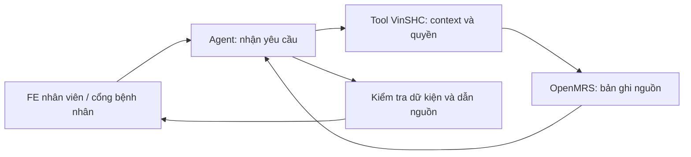

# Kế hoạch tổng quan Agent cho EHR-VinSHC

**Ngày:** 13/10/2026 · cập nhật MVP 14/10/2026

**Trạng thái:** Đã bổ sung tích hợp MVP trong nhánh agent-mvp-integration: A đọc API nhân viên, P đọc cổng bệnh nhân đã công bố; có FE, Compose và CI. Xem [bàn giao](AGENT_MVP_HANDOFF.md). Đánh giá chất lượng/model thật và nâng cấp B/C được để lại theo phạm vi đã chốt.

**Người phụ trách đề xuất:** Người 3 — metadata, dữ liệu và agent.

**Nguồn đối chiếu:** plan ban đầu dùng main@d9d5b95 và fe@b5bd148; cập nhật MVP dựa trên main@33f21f5 và agent@ef9ec3d. Các contract triển khai mới được ghi trong AGENT_MVP_HANDOFF.md và api/patient-portal.md.

## 1. Agent này giúp giải quyết việc gì?

Khi mở hồ sơ, bác sĩ phải đọc phiếu khám, tiền sử, chẩn đoán, thuốc, dị ứng và các kết quả liên quan. Thông tin nằm ở nhiều phần; có trường chưa được khai thác, bản ghi đã sửa hoặc dữ liệu chưa tải được.

Agent có hai luồng: hỗ trợ bác sĩ **đọc nhanh hồ sơ được phép xem**, và giúp bệnh nhân **hiểu thông tin/lời dặn đã được phép cung cấp cho chính mình**. Hai luồng dùng dữ liệu, cách diễn đạt và quyền truy cập khác nhau.

Bản A tập trung vào một lần khám mà bác sĩ đang mở. Bản P dành cho bệnh nhân cần thêm cổng đăng nhập và API truy cập hồ sơ cá nhân; có thể thiết kế/mock song song với A.

Ví dụ người dùng hỏi:

- “Tóm tắt lần khám này giúp tôi.”
- “Trong hồ sơ lần này đã ghi những thuốc nào?”
- “Tiền sử và dị ứng đã được khai thác chưa?”
- Khi có API lịch sử: “So với lần khám trước, hồ sơ có thay đổi gì?”
- Bệnh nhân: “Lời dặn sau lần khám của tôi là gì?”, “Tôi được hẹn tái khám ngày nào?”, “Đơn thuốc đã được xác nhận ghi hướng dẫn gì?”

Thông tin trả lời phải lấy từ bản ghi. Agent không tự bổ sung triệu chứng, coi ô trống là bình thường hoặc biến thông tin chưa hỏi thành kết luận âm tính.

## 2. Ai sử dụng?

| Luồng | Người sử dụng | Mục tiêu | Điều kiện truy cập |
| --- | --- | --- | --- |
| **A — Trợ lý bác sĩ** | Bác sĩ trong workspace được cấp quyền | Tóm tắt và hỏi đáp hồ sơ phục vụ công việc | BE xác nhận user, role/cơ sở và hồ sơ đã chọn |
| **P — Trợ lý bệnh nhân** | Bệnh nhân đã đăng nhập và được liên kết đúng hồ sơ | Hiểu lời dặn/đơn thuốc, xem thông tin được công bố và lịch hẹn của mình | BE xác nhận account → patient và phạm vi dữ liệu được phép cung cấp |

Bác sĩ chọn đúng bệnh nhân/lần khám trước khi yêu cầu agent. Với bệnh nhân, BE xác định hồ sơ từ tài khoản; không cho chọn tùy ý người khác bằng cách nhập UUID.

**BE/FE giữ 8 workspace nhân viên; MVP bổ sung cổng bệnh nhân với role và liên kết account–patient riêng.** Luồng P dùng API công bố hồ sơ, không đổi nhãn role `doctor` thành `patient`. Có thể cùng dùng một service agent với hai policy/tool allowlist, nhưng loại người dùng phải được xác nhận từ session phía server.

Các vai trò khác được mở ở giai đoạn sau, sau khi chốt dữ liệu và quyền cho từng nhiệm vụ. Ví dụ điều dưỡng có thể cần tóm tắt thông tin phục vụ ghi sinh hiệu; phạm vi đọc vẫn phải được BE kiểm tra.

Vai trò quản trị không tự có quyền đọc bệnh án. Agent dùng quyền của người đang sử dụng và cơ sở đang chọn.

## 3. Các phạm vi triển khai

| Giai đoạn | Agent làm gì? | Đầu ra người dùng nhận được | Phụ thuộc |
| --- | --- | --- | --- |
| **A — MVP: một lần khám** | Tóm tắt phiếu khám, tiền sử đã ghi, chẩn đoán, thuốc, dị ứng; trả lời câu hỏi trong phạm vi lần khám; nêu dữ liệu chưa có | Bản tóm tắt ngắn, câu trả lời có nguồn, danh sách thông tin chưa được ghi hoặc chưa tải được | API `clinical-summary` hiện có; contract nguồn/quyền và khung agent trên FE |
| **P — MVP bệnh nhân** | Diễn giải thông tin đã công bố, lời dặn/đơn thuốc đã xác nhận; xem hẹn tái khám và lịch hẹn của mình | Nội dung dễ hiểu, dẫn về hồ sơ được phép xem; nêu điểm chưa rõ để hỏi nhân viên y tế | Đăng nhập/liên kết account–patient, API hồ sơ đã công bố và lịch hẹn cá nhân, UI portal |
| **B — Lịch sử bệnh nhân** | Đọc nhiều lượt/lần khám, lập timeline và đối chiếu thay đổi; thêm sinh hiệu và kết quả CLS | Timeline có ngày, đơn vị, trạng thái và nguồn của từng bản ghi, theo quyền của luồng A/P | API đọc danh sách lượt/encounter, sinh hiệu, chỉ định/kết quả theo bệnh nhân và quyền |
| **C — Tài liệu tham khảo có RAG** | Tra cứu tài liệu/hướng dẫn đã được nhóm cho phép sử dụng, theo phiên bản và phạm vi | Đoạn thông tin tham khảo có tài liệu/trang/mục nguồn; thể hiện rõ nguồn tham khảo và dữ liệu trong bệnh án | Kho tài liệu được duyệt, metadata nguồn/hiệu lực, ingestion và retrieval có kiểm soát |

**MVP chưa tự ghi/chốt phiếu khám, kê hoặc đổi thuốc, đặt chỉ định hay đưa ra chẩn đoán mới.** Những khả năng tạo bản nháp cho bác sĩ duyệt có thể được đề xuất riêng sau khi bản đọc đã được nghiệm thu.

## 4. Hai bản MVP cụ thể sẽ làm gì?

### 4.1. Tóm tắt lần khám

Bản tóm tắt có thể gồm:

1. Lý do khám và bệnh sử đã ghi.
2. Tiền sử cá nhân/gia đình cùng trạng thái khai thác.
3. Nội dung thăm khám đã lưu.
4. Chẩn đoán cùng trạng thái/độ chắc chắn đã ghi.
5. Thuốc trong dữ liệu trả về, giữ đúng trạng thái active/ngừng/hết hạn nếu có.
6. Trạng thái sàng lọc dị ứng được ghi trong phiếu và danh sách dị ứng active mà API trả về.
7. Lời dặn, hướng điều trị và hẹn tái khám đã được bác sĩ ghi.

Mỗi mục có dẫn nguồn. Khi API chỉ cung cấp một phần dữ liệu, tên và nội dung bản tóm tắt phải thể hiện đúng phạm vi đó. Danh sách dị ứng active và trạng thái thuốc có thể phản ánh thời điểm đọc; không coi chúng là snapshot tại ngày khám nếu API chưa cung cấp bằng chứng lịch sử tương ứng.

### 4.2. Hỏi đáp trong hồ sơ đang mở

Agent diễn giải câu hỏi, đọc tool phù hợp và trả lời từ các bản ghi được phép xem. Các số lượng, ngày, đơn vị và trạng thái được đối chiếu bằng code khi có thể.

Chuyển bệnh nhân, lần khám, role hoặc cơ sở phải xóa ngữ cảnh cũ; phản hồi đến muộn của ngữ cảnh cũ không được hiển thị vào hồ sơ mới.

### 4.3. Nêu thông tin thiếu hoặc chưa truy cập được

Phải phân biệt:

- Hồ sơ ghi `not_asked`, `unknown`, `refused` hoặc trạng thái thiếu khác.
- API chưa cung cấp loại dữ liệu đó.
- Request bị từ chối quyền, lỗi hoặc timeout.

Ví dụ khi một nguồn chưa cung cấp sinh hiệu, agent phải nói “chưa có dữ liệu sinh hiệu trong nguồn đang đọc”, không được nói “bệnh nhân chưa được đo sinh hiệu”. Các nhận xét mâu thuẫn dữ liệu chỉ thực hiện khi có quy tắc rõ ràng; không tự đặt ngưỡng chuyên môn.

### 4.4. Trợ lý bệnh nhân (P)

- Giải thích lời dặn sau khám bằng cách diễn đạt dễ hiểu, dựa vào nội dung bác sĩ đã xác nhận và cho phép cung cấp.
- Đọc lại hướng dẫn trong đơn đã xác nhận; không tự suy giờ uống, đổi liều, ngừng thuốc hoặc bổ sung thuốc khi nguồn chưa ghi rõ.
- Hiển thị hẹn tái khám/lịch hẹn của chính bệnh nhân khi API tương ứng đã có.
- Trả lời câu hỏi về phần hồ sơ được công bố, có nguồn và nêu thông tin chưa rõ để bệnh nhân hỏi nhân viên y tế.

Sau MVP P có thể thêm **nhắc lịch tự động** và **gửi câu hỏi/thông tin tự báo cáo cho phòng khám**. Các chức năng này cần scheduler/kênh thông báo hoặc API yêu cầu hỗ trợ; thao tác gửi cần bệnh nhân xác nhận. Thông tin bệnh nhân tự báo cáo là bản ghi riêng, không tự trở thành chẩn đoán hay phiếu khám đã chốt.

**Cần chốt chính sách công bố:** phiếu `final` chưa tự đồng nghĩa toàn bộ nội dung được phát cho bệnh nhân. BE phải trả đúng phần được phép cung cấp; không gửi cả hồ sơ nội bộ xuống agent/FE rồi chỉ giấu trên giao diện. Contact/người nhà trong dữ liệu hành chính không tự có quyền đọc hồ sơ.

## 5. Dữ liệu và API hiện có

Base API ứng dụng hiện tại: `/openmrs/ws/rest/v1/vinshc`.

| Nguồn | Hiện có gì? | Dùng trong agent |
| --- | --- | --- |
| `GET /encounter/{encounterUuid}/clinical-summary` | Patient/visit/encounter UUID, thời điểm, draft/final, phiếu khám, chẩn đoán, drug orders, dị ứng và events | Nguồn chính cho MVP. Một encounter và sinh hiệu của visit; kết quả CLS đọc qua tool riêng |
| `GET /allergy?patient={patientUuid}` | Danh sách dị ứng active có kiểm tra quyền/phạm vi | Tool bổ sung khi cần đọc riêng; summary hiện đã có dữ liệu dị ứng, tránh gọi trùng không cần thiết |
| `GET /identity/{patientUuid}` | Contact, address snapshot và field states | Chỉ đọc khi có nhu cầu cụ thể. Đây chưa phải DTO đầy đủ tên/ngày sinh/định danh của Person/Patient |
| `GET /authorization/workspace` | Xác nhận workspace role/cơ sở của tài khoản | Kiểm tra context và quyền phía server; headers lựa chọn workspace không tự cấp quyền |
| API operations đọc danh sách/UUID | Chỉ định, kết quả, appointment, attachment | Tool tìm danh sách theo bệnh nhân rồi đọc kết quả bằng mã tham chiếu do tool cấp |
| API portal | Session account–patient, visits/instructions/prescriptions đã công bố và appointments của chính mình | Nguồn riêng của luồng P; không đọc DTO nhân viên |

MVP có thể thử bằng encounter UUID của fixture được chọn trước, ngay cả khi màn hình tìm bệnh nhân chưa hoàn thiện. Đây là cách thử kỹ thuật; trải nghiệm người dùng hoàn chỉnh vẫn cần FE/BE nối luồng chọn hồ sơ.

### Những contract cần chốt với BE

- Context tối thiểu: patient, visit, encounter, cơ sở, thời gian và trạng thái; xác nhận các UUID thuộc đúng quan hệ.
- Trả nguồn của từng dữ kiện: loại bản ghi, UUID, field code, thời điểm và trạng thái/revision khi có.
- Quy tắc đọc phiếu đã sửa/hủy, encounter chưa có phiếu và dữ liệu thiếu.
- DTO hành chính tối thiểu được phép xem nếu cần hiển thị tên/ngày sinh.
- Cho giai đoạn B: danh sách lượt/encounter, sinh hiệu và chỉ định/kết quả, có lọc, phân trang và scope.
- Cho P: liên kết account–patient được BE xác nhận, chính sách công bố hồ sơ/đơn/kết quả, API đọc và lịch hẹn cá nhân. Các API nhân viên ở bảng trên chưa được coi là API dành cho bệnh nhân.
- Nếu mở P+: contract thông báo và yêu cầu hỗ trợ, người nhận/trạng thái xử lý, xác nhận thao tác gửi và cách lưu thông tin tự báo cáo.

Các API bổ sung là yêu cầu cần BE thống nhất; tài liệu này không tự đặt URL rồi coi URL đó đã tồn tại.

## 6. Cách agent hoạt động

Luồng xử lý:

1. FE nhân viên gửi câu hỏi và patient/encounter đang chọn. Portal bệnh nhân gửi câu hỏi và lần khám trong phạm vi tài khoản của mình.
2. Agent service xác thực người dùng với BE: workspace role/cơ sở cho A, account–patient và phạm vi công bố cho P. Giữ thông tin xác thực ở tầng HTTP, ngoài prompt/model.
3. Tool chỉ đọc các bản ghi thuộc context đã kiểm tra. Model không được chọn tùy ý bệnh nhân, URL hoặc câu SQL.
4. Chuẩn hóa dữ liệu: giữ đơn vị, thời gian, mã, trạng thái thiếu và nguồn; loại dữ liệu không cần cho câu hỏi.
5. LangGraph điều phối đọc nguồn, tạo câu trả lời có cấu trúc và kiểm tra kết quả.
6. Validator kiểm tra nguồn có trong dữ liệu đã đọc, UUID khớp hồ sơ và các giá trị quan trọng đúng bản ghi. Khi không đủ nguồn hoặc kiểm tra thất bại, trả thông báo hạn chế thay vì kết luận không có dữ liệu.
7. FE hiển thị kết quả, nguồn và nhãn “AI hỗ trợ — cần bác sĩ kiểm tra”.

## 7. Công nghệ và vị trí code đề xuất

- **Python + FastAPI:** service riêng cho API agent.
- **LangGraph:** điều phối context, tool calls, tạo câu trả lời, validation và fallback.
- **LLM provider:** cấu hình độc lập; chốt model sau benchmark chất lượng, độ trễ và chi phí. Có thể dùng fake model để làm contract/test trước.
- **OpenMRS/VinSHC API:** nguồn dữ liệu bệnh án. MVP đọc dữ liệu theo request, chưa cần sao chép toàn bộ bệnh án vào vector database.
- **RAG/pgvector:** bổ sung ở giai đoạn C cho tài liệu được duyệt, sau khi chốt scope, phiên bản và nguồn.

Code agent nằm **trong cùng repo**, thư mục [`infra/agent/`](../infra/agent/README.md), cạnh `infra/backend/` và `infra/frontend/`. Dockerfile của agent nằm cùng thư mục và build từ gốc repo. Chatbot (FastAPI + LangGraph, tool theo vai trò, prompt/guardrail, fake model và adapter Claude) đã có; FE và Compose/CI đã được nối cho MVP.

Agent được triển khai độc lập nhưng đi qua cùng cơ chế xác thực/phân quyền. Contract ủy quyền cụ thể cần BE review; không dùng tài khoản admin chung để đọc thay tất cả người dùng.

Cùng service có thể có policy A/P riêng: nguồn được phép đọc, tool, prompt và output khác nhau. Model không được tự chọn policy bằng nội dung câu hỏi; policy được quyết định từ danh tính đã xác thực.

## 8. FE sẽ hiển thị như thế nào?

Trong hồ sơ bác sĩ đang mở, thêm một khung “Trợ lý hồ sơ”:

- Nút “Tóm tắt lần khám”.
- Ô hỏi đáp về hồ sơ hiện tại.
- Kết quả chia mục, có nguồn và thời điểm tạo.
- Bấm nguồn để mở/đối chiếu phần tương ứng của lần khám qua giao diện được phép xem.
- Hiển thị thông tin thiếu, lỗi quyền, mất kết nối và model chưa sẵn sàng.

Trong cổng bệnh nhân, thêm khung “Trợ lý hồ sơ của tôi”: chọn trong các lần khám được phép xem, hỏi về lời dặn/đơn đã xác nhận, xem hẹn tái khám và mở nguồn đã công bố. Nội dung dùng ngôn ngữ dễ hiểu; không có ô nhập UUID để truy cập tùy ý hồ sơ khác. Cổng này là phần FE cần xây thêm.

Dẫn nguồn không phải link thẳng sang Core REST/FHIR: app roles hiện bị chặn truy cập trực tiếp các API đó. FE cần mở lại dữ liệu bằng API VinSHC được cấp quyền.

## 9. Các quy tắc cần giữ từ đầu

- MVP chỉ dùng tool đọc nằm trong allowlist; không có tool ghi/chốt hoặc đổi thuốc.
- BE kiểm quyền mỗi lần đọc. Context từ FE/model không được coi là bằng chứng có quyền.
- Bệnh nhân chỉ đọc phần hồ sơ được công bố cho mình. Test riêng trường hợp sửa UUID, chuyển tài khoản, truy cập bản nháp và giả mạo actor/role.
- Giữ nguyên ý nghĩa trạng thái thiếu; không đổi null thành 0 hoặc “không có bệnh/dị ứng”.
- Chỉ lấy dữ liệu cần cho yêu cầu; mặc định không đưa CCCD, số điện thoại, địa chỉ và credential vào prompt.
- Nội dung trong hồ sơ/tài liệu là dữ liệu, không phải chỉ thị để đổi quyền hay điều khiển tool.
- Có giới hạn tool rounds, token, thời gian và retry; ghi request ID, nguồn đã đọc, trạng thái, latency và cost để debug. Không log mặc định toàn bộ bệnh án hoặc prompt chứa dữ liệu cá nhân.
- Khi API trả 403, thiếu dữ liệu, lỗi hoặc model không sẵn sàng, FE vẫn cho bác sĩ đọc hồ sơ qua luồng hiện có.

## 10. Đánh giá agent bằng cách nào?

Người 3 chuẩn bị **10–20 ca synthetic ban đầu**, mỗi ca có dữ liệu nguồn và kết quả mong đợi. Tăng bộ test khi thêm loại dữ liệu/chức năng.

| Nhóm ca | Điều cần kiểm tra |
| --- | --- |
| Hồ sơ đủ | Tóm tắt đúng dữ kiện, không thêm thông tin, dẫn nguồn đúng |
| Thông tin thiếu | Phân biệt chưa hỏi, không rõ, từ chối và nguồn chưa cung cấp |
| Nhiều lần khám/đổi context | Không trộn bệnh nhân, thời gian hoặc encounter |
| Bản ghi sửa/hủy/thuốc ngừng | Giữ đúng trạng thái và lịch sử mà API cung cấp |
| Sai quyền/sai cơ sở | Bị từ chối, không trả dữ liệu vượt quyền |
| Lỗi API/model | Thông báo rõ, không giả danh sách rỗng hoặc tạo nội dung thay thế |
| Prompt injection | Nội dung bệnh án không điều khiển được tool/quyền |
| Câu hỏi ngoài nguồn | Nêu giới hạn hoặc yêu cầu bổ sung nguồn/context |
| Bệnh nhân A truy cập bệnh nhân B | Server/tool từ chối, không có dữ liệu B trong prompt hoặc phản hồi |
| Hồ sơ chưa được công bố | Luồng P không đọc/hiển thị bản nháp hoặc phần chỉ dành cho nhân viên |
| Lời dặn/đơn thiếu thông tin | Diễn giải đúng phần đã ghi; không tự thêm hướng dẫn hay thay đổi chỉ định |

Đo: độ đúng/đủ của bản tóm tắt, tỷ lệ dữ kiện có nguồn hợp lệ, lỗi trộn context/quyền, p50/p95 latency, số tool/model calls và cost mỗi lượt. Chưa đặt số cải thiện hay độ chính xác trước khi đo.

**Điều kiện nghiệm thu MVP:** các ca sai quyền/context phải đạt; nguồn tham chiếu kiểm tra được; thông tin không có nguồn không được trình bày như dữ kiện; bác sĩ/mentor review cách diễn đạt. Báo cáo phải ghi mẫu số, commit, môi trường và giới hạn của bộ synthetic.

## 11. Phân công và thứ tự triển khai

| Việc | Người phụ trách | Đầu ra |
| --- | --- | --- |
| Chốt phạm vi A và contract dữ liệu/nguồn | Người 3 + BE + FE | Danh sách câu hỏi hỗ trợ, input/output, API hiện có và gap |
| Chốt P: dữ liệu được công bố, liên kết tài khoản và ngôn ngữ bệnh nhân | Người 3 + BE + FE + mentor | Contract patient portal, policy A/P và ca kiểm tra quyền |
| Tạo fixtures + expected results | Người 3; mentor review phần cần chuyên môn | Bộ ca synthetic và tiêu chí chấm |
| Xác nhận/bổ sung API đọc, context và ủy quyền | BE, phối hợp người 4 | DTO và kiểm thử quyền/liên kết thực tế |
| Xây service, graph, tool adapters và validators | Người 3 | Agent MVP chạy riêng, có mock và test |
| Nối khung agent vào hồ sơ/workspace | FE + người 3 | UI tóm tắt/hỏi đáp/nguồn/lỗi, reset context đúng |
| Xây và nối portal bệnh nhân | BE + FE + người 3 | Đăng nhập/liên kết tài khoản, API cá nhân, UI và agent P |
| Chạy E2E và đánh giá | Người 3 + người 4 + BE/FE | Kết quả synthetic tái lập, lỗi và quyết định nghiệm thu |
| Mở rộng B, rồi C | Cả nhóm chốt sau MVP | Timeline/CLS, rồi kho tài liệu RAG |

Có thể làm service và fixtures A/P song song với FE hoàn thiện/ghép nhánh. A có thể nối API sẵn có trước; P chỉ nối dữ liệu thật của môi trường test sau khi contract danh tính/quyền/công bố được kiểm chứng. Khi bắt đầu code agent, tạo nhánh từ `main` mới nhất; không lấy nhánh metadata cũ làm nền triển khai.

## 12. Việc đầu tiên cần làm sau khi duyệt plan

1. Chốt hai phạm vi: A tóm tắt/hỏi đáp **một lần khám được chọn** cho bác sĩ; P giải thích **thông tin đã công bố của chính bệnh nhân**. Xác định khả năng làm song song và phụ thuộc portal của P.
2. Lập bảng từng dữ liệu cần → API đang có → trường/nguồn còn thiếu; gửi BE thống nhất.
3. Chọn 10–20 fixture và viết expected output trước khi tối ưu prompt/model.
4. Chốt contract ủy quyền, vị trí service và cách FE truyền context; sau đó bắt đầu triển khai agent.

## 13. Nguồn đối chiếu

- [Clinical summary trên main đã kiểm tra](https://github.com/viet041105/EHR-VinSHC/blob/d9d5b957223f6bc73db173dbbc1d413910689526/infra/backend/vinshc-module/omod/src/main/java/org/openmrs/module/vinshc/service/ClinicalService.java).
- [Phân quyền và audit trên main](https://github.com/viet041105/EHR-VinSHC/blob/d9d5b957223f6bc73db173dbbc1d413910689526/docs/api/authorization-audit.md).
- [Mapping và giới hạn FHIR trên main](https://github.com/viet041105/EHR-VinSHC/blob/d9d5b957223f6bc73db173dbbc1d413910689526/docs/api/fhir-mapping.md).
- [Ánh xạ UI/API và chức năng còn chờ ở FE](../infra/frontend/docs/UI_BACKEND_MAP.md).

Khi BE/FE đổi contract hoặc bổ sung endpoint, cập nhật bảng API và bộ fixture trước khi mở rộng phạm vi agent.

## 14. Phạm vi hoàn thiện MVP đã chốt

MVP A/P, FE, patient portal, phân quyền/công bố, Docker và CI được thực hiện trong lần này. Test code/phân quyền/tích hợp vẫn bắt buộc; bộ đánh giá chất lượng với đáp án chuẩn và model thật, timeline nâng cao và RAG được để lại. Các mô tả API ở bản plan ban đầu là snapshot cũ; contract mới xem [patient portal](api/patient-portal.md) và [bàn giao MVP](AGENT_MVP_HANDOFF.md).
