# Sơ đồ toàn hệ thống VinSHC

Tài liệu gom các sơ đồ Mermaid mô tả hệ thống ở trạng thái hiện tại của `main` (16/10/2026): bối cảnh, triển khai Docker, thành phần backend/frontend/agent, phân quyền, luồng nghiệp vụ, database và CI. Lộ trình tầng 2–3 ở cuối là **kế hoạch**, chưa triển khai.

Mục lục:

1. [Bối cảnh hệ thống](#1-bối-cảnh-hệ-thống)
2. [Triển khai Docker Compose](#2-triển-khai-docker-compose)
3. [Thành phần backend](#3-thành-phần-backend)
4. [Thành phần frontend](#4-thành-phần-frontend)
5. [Trợ lý AI (agent)](#5-trợ-lý-ai-agent)
6. [Các lớp bảo mật và phân quyền](#6-các-lớp-bảo-mật-và-phân-quyền)
7. [Luồng một lần khám](#7-luồng-một-lần-khám)
8. [Luồng bác sĩ hỏi trợ lý](#8-luồng-bác-sĩ-hỏi-trợ-lý)
9. [Luồng công bố hồ sơ cho người bệnh](#9-luồng-công-bố-hồ-sơ-cho-người-bệnh)
10. [Database: bảng VinSHC và liên kết với OpenMRS](#10-database-bảng-vinshc-và-liên-kết-với-openmrs)
11. [Build và CI](#11-build-và-ci)
12. [Lộ trình mở rộng](#12-lộ-trình-mở-rộng)

---

## 1. Bối cảnh hệ thống

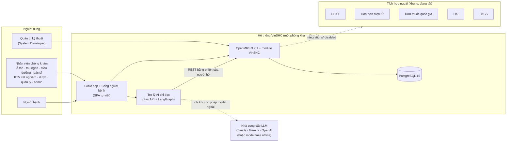

## 2. Triển khai Docker Compose

`compose.yaml` là baseline OpenMRS; `compose.agent.yaml` thêm agent và clinic app. Chỉ hai cổng mở ra máy host, đều bind `127.0.0.1`.

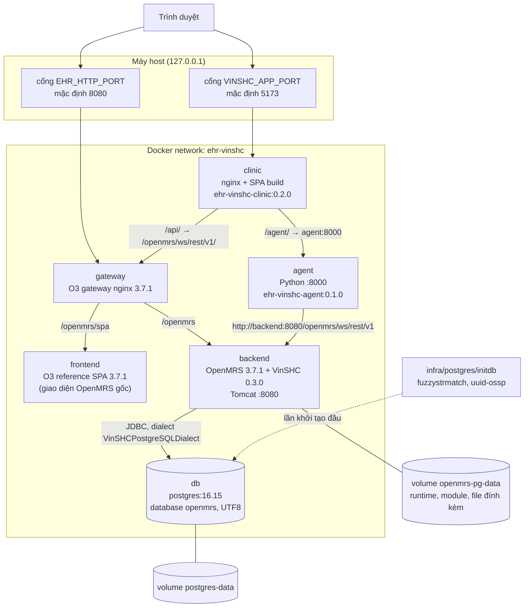

Thứ tự khởi động theo healthcheck: `db` (pg_isready) → `backend` (`/openmrs/health/started`) → `frontend` → `gateway` → `agent` → `clinic`.

## 3. Thành phần backend

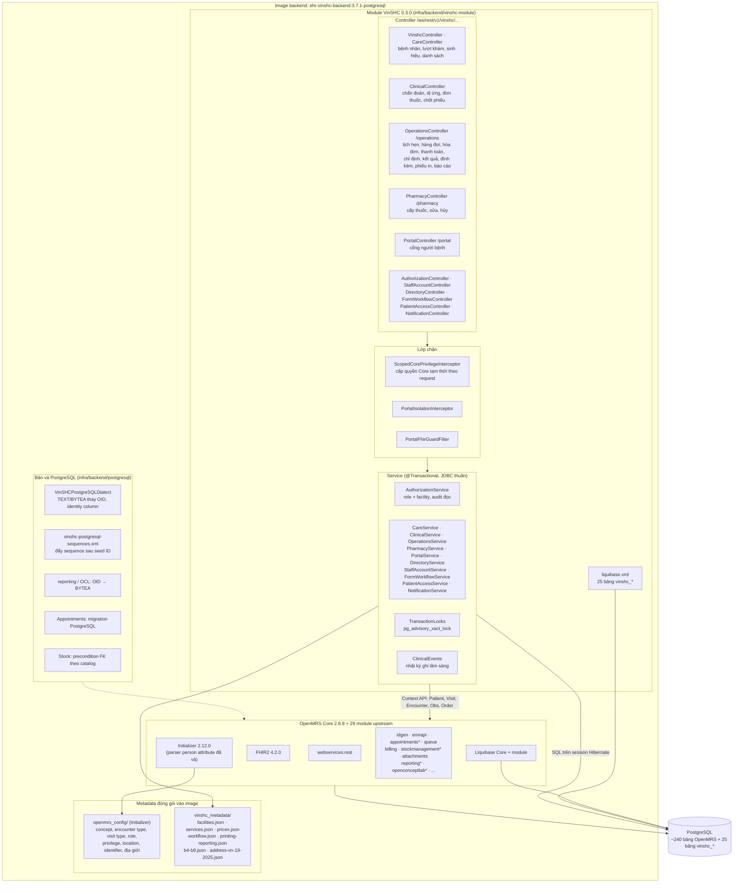

`*` là module có bản vá PostgreSQL. Lịch hẹn, hàng đợi, billing và cấp thuốc của ứng dụng dùng bảng `vinshc_*`; module upstream tương ứng vẫn khởi động nhưng không là hợp đồng của ứng dụng.

## 4. Thành phần frontend

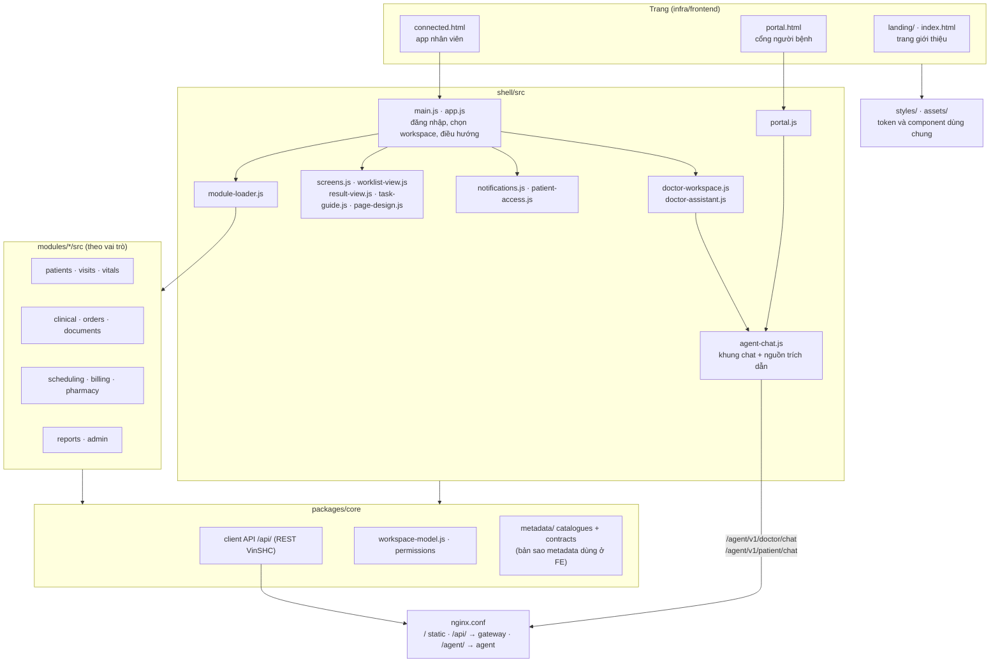

## 5. Trợ lý AI (agent)

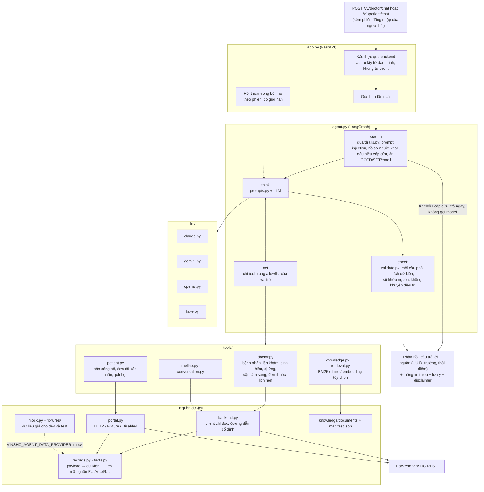

Agent không có database riêng và không ghi gì vào hồ sơ.

## 6. Các lớp bảo mật và phân quyền

```mermaid
flowchart LR
    Req["Request từ trình duyệt"]

    subgraph L1["Lớp mạng"]
        Bind["Chỉ bind 127.0.0.1"]
        Proxy["nginx clinic / gateway"]
    end

    subgraph L2["Lớp xác thực"]
        Session["Phiên OpenMRS (JSESSIONID)"]
        PortalAcc["vinshc_portal_account<br/>+ portal_link_event (xác minh)"]
    end

    subgraph L3["Lớp phân quyền VinSHC"]
        Role["Ma trận vai trò × thao tác<br/>requireOperation"]
        Workspace["vinshc_workspace_assignment<br/>một role + một cơ sở / tài khoản"]
        Scope["Phạm vi cơ sở<br/>bệnh nhân có visit/registration tại cây location"]
        Enc["Phạm vi encounter<br/>location của encounter thuộc cơ sở"]
        Agentscope["Gán bệnh nhân cho agent<br/>requireAgentAssignment"]
    end

    subgraph L4["Chặn đường vòng"]
        CoreBlock["Core REST/FHIR trực tiếp: 403 với role ứng dụng"]
        TempPriv["Quyền Core chỉ cấp tạm trong request /vinshc/**"]
        PortalBlock["Tài khoản người bệnh chỉ vào /vinshc/portal"]
    end

    subgraph L5["Kiểm toán"]
        AccessEv["vinshc_access_event<br/>mọi lần đọc hồ sơ"]
        ClinEv["vinshc_clinical_event<br/>mọi lần ghi / sửa / hủy"]
        AdminEv["vinshc_admin_event<br/>quản trị tài khoản, cơ sở"]
    end

    Req --> L1 --> L2 --> L3 --> L4
    L3 --> L5
```

## 7. Luồng một lần khám

Các điểm hàng đợi theo `workflow.json`. Cơ sở chọn một trong hai quy trình: `STANDARD_POSTPAY` hoặc `COMPACT_PREPAY` (`vinshc_facility_workflow`).

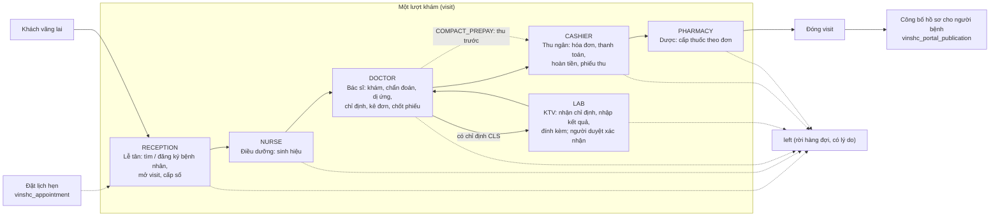

## 8. Luồng bác sĩ hỏi trợ lý

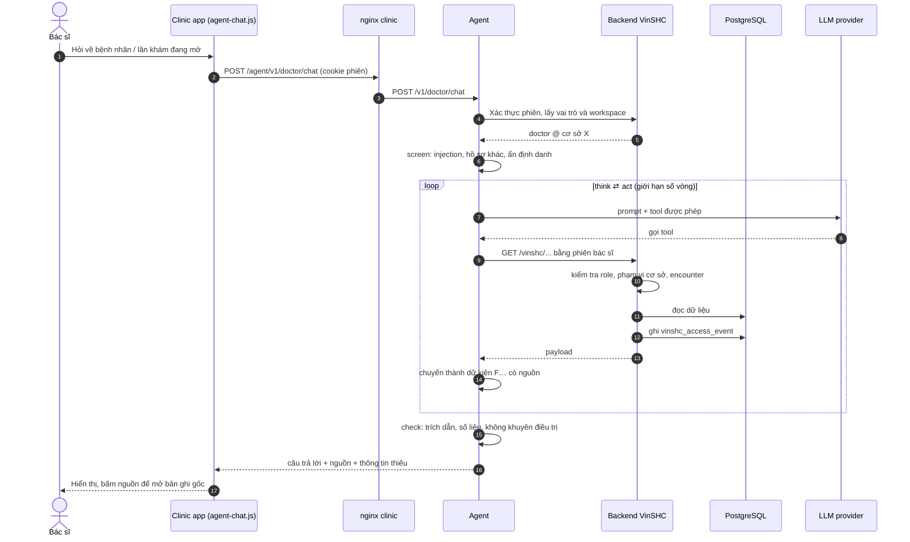

## 9. Luồng công bố hồ sơ cho người bệnh

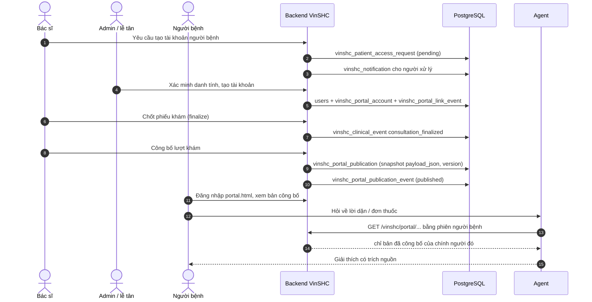

## 10. Database: bảng VinSHC và liên kết với OpenMRS

Bảng viết hoa là bảng gốc OpenMRS (chỉ liệt kê cột khóa). Chi tiết cột ở `infra/backend/vinshc-module/api/src/main/resources/liquibase.xml`.

```mermaid
erDiagram
    PATIENT {
        int patient_id PK
    }
    VISIT {
        int visit_id PK
        int patient_id FK
        int location_id FK
    }
    ENCOUNTER {
        int encounter_id PK
        int visit_id FK
    }
    ORDERS {
        int order_id PK
        int encounter_id FK
    }
    LOCATION {
        int location_id PK
        int parent_location FK
    }
    USERS {
        int user_id PK
    }
    PROVIDER {
        int provider_id PK
    }

    PATIENT ||--o{ VISIT : has
    VISIT ||--o{ ENCOUNTER : has
    ENCOUNTER ||--o{ ORDERS : has
    LOCATION ||--o{ VISIT : at

    vinshc_contact {
        bigint contact_id PK
        varchar row_key
        int version_number
        int patient_id FK
        boolean is_current
        varchar status
    }
    vinshc_field_state {
        bigint field_state_id PK
        int patient_id FK
        varchar field_code
        varchar data_status
        boolean is_current
    }
    vinshc_address_snapshot {
        bigint address_id PK
        varchar row_key
        int patient_id FK
        varchar province_code
        varchar commune_code
        boolean is_current
    }
    vinshc_patient_registration {
        bigint registration_id PK
        int patient_id FK
        int facility_location_id FK
        varchar idempotency_key UK
    }
    PATIENT ||--o{ vinshc_contact : "liên hệ"
    PATIENT ||--o{ vinshc_field_state : "trạng thái trường"
    PATIENT ||--o{ vinshc_address_snapshot : "địa chỉ"
    PATIENT ||--o{ vinshc_patient_registration : "đăng ký tại"
    LOCATION ||--o{ vinshc_patient_registration : "cơ sở"

    vinshc_business_facility {
        varchar facility_uuid PK
        int location_id FK
        varchar facility_code UK
        varchar timezone
        boolean active
    }
    vinshc_workspace_assignment {
        bigint assignment_id PK
        int user_id FK
        varchar role_name
        int facility_location_id FK
        boolean active
    }
    vinshc_provider_link {
        varchar link_uuid PK
        int user_id FK
        int provider_id FK
        int facility_location_id FK
    }
    vinshc_facility_workflow {
        int facility_location_id PK
        varchar workflow_code
    }
    vinshc_form_definition {
        varchar form_uuid PK
        varchar form_code
        int facility_location_id FK
        int version_number
        varchar state
    }
    LOCATION ||--o| vinshc_business_facility : "pháp nhân"
    LOCATION ||--o| vinshc_facility_workflow : "quy trình"
    LOCATION ||--o{ vinshc_form_definition : "biểu mẫu"
    USERS ||--o{ vinshc_workspace_assignment : "làm việc tại"
    USERS ||--o{ vinshc_provider_link : "là provider"
    PROVIDER ||--o{ vinshc_provider_link : "liên kết"

    vinshc_appointment {
        bigint appointment_id PK
        int patient_id FK
        int visit_id FK
        int provider_id FK
        timestamptz start_at
        timestamptz end_at
        varchar status
    }
    vinshc_queue_item {
        bigint queue_item_id PK
        int visit_id FK
        varchar point_code
        int iteration
        int queue_number
        varchar state
    }
    PATIENT ||--o{ vinshc_appointment : "hẹn"
    VISIT |o--o{ vinshc_appointment : "check-in"
    VISIT ||--o{ vinshc_queue_item : "hàng đợi"

    vinshc_bill {
        bigint bill_id PK
        int visit_id FK
        varchar facility_uuid
        text lines_json
        bigint total_vnd
        varchar status
    }
    vinshc_payment {
        bigint payment_id PK
        bigint bill_id FK
        varchar kind
        bigint original_payment_id FK
        bigint amount_vnd
        varchar status
    }
    VISIT ||--o{ vinshc_bill : "hóa đơn"
    vinshc_bill ||--o{ vinshc_payment : "thanh toán"
    vinshc_payment |o--o{ vinshc_payment : "hoàn tiền của"

    vinshc_service_order {
        bigint service_order_id PK
        int order_id FK
        int encounter_id FK
        bigint bill_id FK
        varchar service_code
        varchar state
    }
    vinshc_result_revision {
        bigint result_id PK
        bigint service_order_id FK
        int version_number
        bigint previous_result_id FK
        varchar state
    }
    vinshc_attachment {
        bigint attachment_id PK
        bigint service_order_id FK
        bigint result_id FK
        varchar storage_key UK
        varchar sha256
    }
    ORDERS ||--o| vinshc_service_order : "chỉ định dịch vụ"
    vinshc_bill |o--o{ vinshc_service_order : "tính tiền"
    vinshc_service_order ||--o{ vinshc_result_revision : "kết quả"
    vinshc_result_revision |o--o{ vinshc_result_revision : "sửa từ"
    vinshc_service_order ||--o{ vinshc_attachment : "file"

    vinshc_dispense {
        bigint dispense_id PK
        int order_id FK
        numeric quantity
        varchar batch_number
        varchar status
    }
    vinshc_dispense_revision {
        bigint revision_id PK
        bigint dispense_id FK
        int version_number
        varchar action
    }
    ORDERS ||--o{ vinshc_dispense : "cấp thuốc"
    vinshc_dispense ||--o{ vinshc_dispense_revision : "sửa / hủy"

    vinshc_document {
        bigint document_id PK
        varchar template_code
        varchar source_uuid
        varchar document_number UK
        text payload_json
    }

    vinshc_portal_account {
        int user_id PK
        int patient_id FK
        boolean active
    }
    vinshc_portal_link_event {
        bigint event_id PK
        int user_id FK
        int patient_id FK
        int version_number
        varchar status
    }
    vinshc_portal_publication {
        bigint publication_id PK
        int visit_id FK
        int encounter_id FK
        int version
        text payload_json
        boolean active
    }
    vinshc_portal_publication_event {
        bigint event_id PK
        bigint publication_id FK
        varchar status
    }
    vinshc_patient_access_request {
        varchar request_uuid PK
        varchar request_type
        int patient_id FK
        int requester FK
        varchar status
    }
    vinshc_notification {
        bigint notification_id PK
        int recipient_id FK
        varchar event_key
        timestamptz read_at
    }
    USERS ||--o| vinshc_portal_account : "tài khoản người bệnh"
    PATIENT ||--o{ vinshc_portal_account : "thuộc về"
    USERS ||--o{ vinshc_portal_link_event : "xác minh"
    VISIT ||--o{ vinshc_portal_publication : "công bố"
    vinshc_portal_publication ||--o{ vinshc_portal_publication_event : "vòng đời"
    PATIENT ||--o{ vinshc_patient_access_request : "yêu cầu"
    USERS ||--o{ vinshc_notification : "nhận"

    vinshc_clinical_event {
        bigint event_id PK
        varchar event_type
        int patient_id FK
        int encounter_id FK
    }
    vinshc_access_event {
        bigint event_id PK
        varchar resource_type
        int patient_id FK
        varchar action
    }
    vinshc_admin_event {
        bigint event_id PK
        varchar action
        varchar entity_uuid
    }
    PATIENT ||--o{ vinshc_clinical_event : "nhật ký ghi"
    PATIENT |o--o{ vinshc_access_event : "nhật ký đọc"
    USERS ||--o{ vinshc_admin_event : "thực hiện"
```

Nhóm bảng theo chức năng:

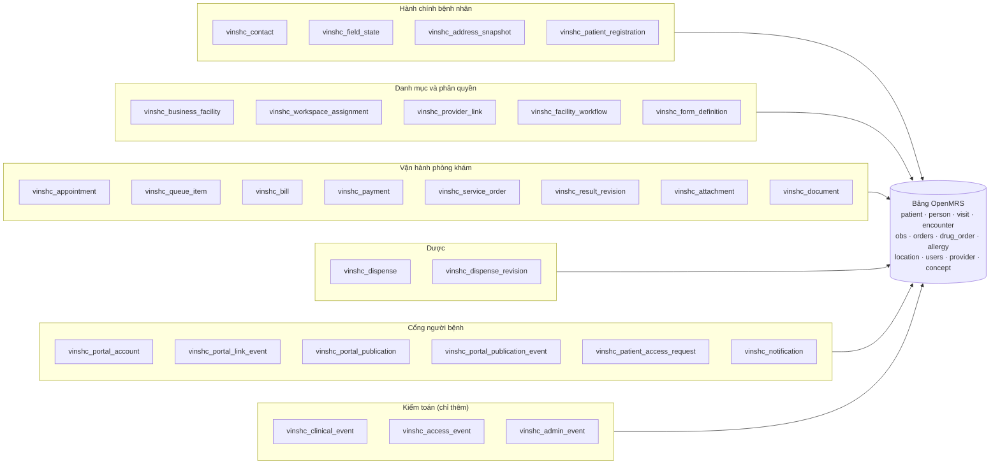

## 11. Build và CI

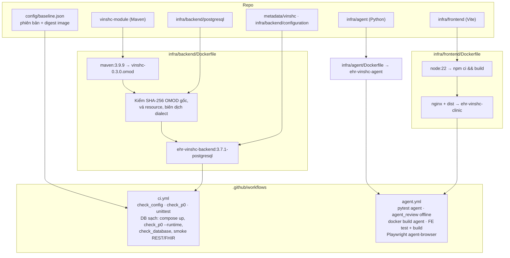

## 12. Lộ trình mở rộng

Theo [ARCHITECTURE.md](ARCHITECTURE.md). Chỉ tầng 1 đã triển khai.

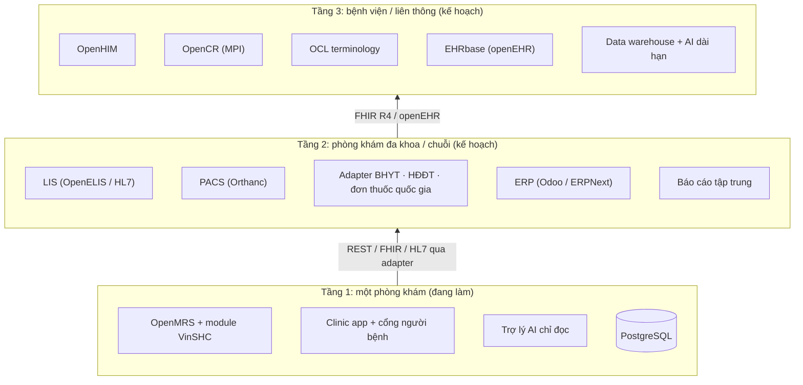
